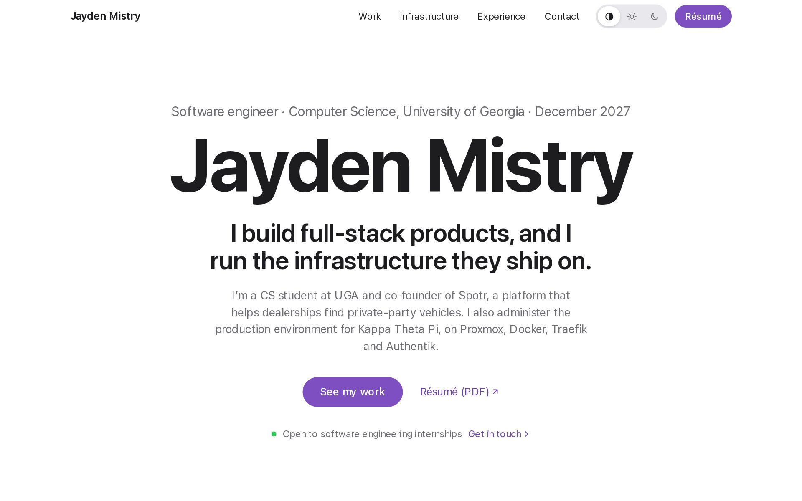

# jmistry.com

This is the source for my portfolio, live at [jmistry.com](https://jmistry.com).
I'm a computer science student at the University of Georgia, and I'm looking
for a software engineering internship. The site covers the products I've built
and the infrastructure I run, and it's hosted on that infrastructure too.

[Live site](https://jmistry.com) · [Résumé](https://jmistry.com/resume.pdf) ·
[LinkedIn](https://www.linkedin.com/in/jayden-mistry)

<picture>
  <source media="(prefers-color-scheme: dark)" srcset="docs/screenshot-dark.jpg">
  
</picture>

## At a glance

- Next.js 16 and TypeScript, designed from a written set of rules based on
  Apple's Human Interface Guidelines, in light and dark mode.
- Self-hosted on my homelab. Each push to `main` deploys only after CI passes,
  and a release that fails its health check rolls back by itself.
- Lighthouse scores 100 for accessibility and SEO, and 100 for performance on
  desktop. The test suite runs axe accessibility checks in both themes.
- A strict Content Security Policy and other security headers, with a test
  that fails if a header goes missing or the page breaks the policy.
- No cookies and no third-party analytics. Visits are counted by Umami, which
  I host myself.

## Stack

| Area | Tools |
|---|---|
| Framework | Next.js 16 (App Router), React 19, TypeScript |
| Styling and motion | Tailwind CSS, Motion for gestures and springs, CSS scroll-driven animations |
| Testing | Playwright, axe-core, GitHub Actions |
| Hosting | Docker, Traefik, Cloudflare, systemd |
| Services | Umami (self-hosted analytics), Formspree (contact form), Calendly (scheduling) |

## Design decisions

I based the design on Apple's Human Interface Guidelines. Apple's sites put the
content first and apply a small set of rules everywhere, which is what I wanted
for a portfolio. I wrote every rule down in [`DESIGN.md`](DESIGN.md), so the
site stays consistent as I change it. These are the bigger decisions.

**Color.** The palette is neutral surfaces with one purple accent. Every color
is a token with a light and a dark value, and components only use the tokens,
never raw hex values. I checked each text and background pair against WCAG AA
contrast and recorded the ratios in `DESIGN.md`. The accent is a lighter shade
in dark mode so it still passes there.

**Type.** On Apple devices the site uses SF Pro from the system. Apple's
license doesn't allow serving SF Pro from a website, so everywhere else it uses
Inter, the closest open font, which I self-host. Apple devices pick the system
font first, so they never download Inter.

**Theme.** The site follows the operating system's light or dark setting by
default, and visitors can pin Light or Dark. A small script applies the saved
choice before the page first paints, so it never flashes the wrong theme.

**Motion.** Animations use springs set by damping and response, the same two
parameters Apple uses, so they settle naturally and can be interrupted
mid-animation. The mobile menu sheet and the screenshot viewer follow your
finger, and whether they close depends on how fast you flick them. Scroll
reveals are tied to scroll position instead of timers, so jumping to a section
from a link shows it already in place. Text never fades in, and with reduced
motion turned on everything just shows in its final state.

**Content.** All of the copy lives in one file, [`lib/data.ts`](lib/data.ts).
I don't put any metric or date on the site that isn't real, so if a fact is
missing the page leaves that field out instead of showing a placeholder.

## Engineering decisions

**Self-hosting.** I run the site on my own server, because running
infrastructure is half of what the portfolio is about. Requests come
through Cloudflare to Traefik, which routes them to the site's Docker
container. The image is a multi-stage build that runs Next.js in standalone
mode as a non-root user.

**Deploys.** A systemd timer on the server checks GitHub every two minutes.
When `main` has a new commit and its CI build passed, it pulls the commit,
rebuilds the image and waits for the container's health check. If the new
version isn't healthy it puts the previous image back, and either way it sends
me a Discord message. A commit that fails CI never deploys. The script and its
systemd units are in [`deploy/homelab`](deploy/homelab).

**CI.** Every push runs a dependency audit that fails on high or critical
advisories, then lint, a production build and the Playwright tests. The tests
cover navigation, the mobile menu, the theme control, the screenshot viewer,
contact form validation, the security headers, and axe checks on every page in
both themes. Dependabot opens grouped update PRs each week, so upgrades go
through the same checks.

**Analytics and privacy.** Umami runs next to the site, and the site serves its
script and event endpoint under its own `/stats` path. So visitors never
connect to a separate analytics host, and the dashboard stays private on my
network. Umami doesn't use cookies, so the site doesn't need a cookie banner. A
nightly job backs up its database. The [privacy page](https://jmistry.com/privacy)
only states practices I've checked in the code or on the server.

## How I use AI

I use AI coding tools to save time on the tedious parts of a project. I don't
use them to generate the project for me, the design, the structure and the
decisions are mine. Specifically, I use them for things like:

- writing boilerplate and repetitive markup once I've decided what a component
  should do
- drafting Playwright tests, and scripts that measure the layout, like checking
  that every dot on a timeline sits on its line at each screen width
- checking contrast ratios across the color tokens
- reading through changelogs and security advisories when I upgrade
  dependencies
- first drafts of shell scripts and documentation

I read every line it writes before it gets committed, and I change or throw out
anything I don't understand or don't agree with. AI can be confidently wrong,
so I review its output the same way I'd review a pull request from someone
else. For example, during one upgrade it pinned Next.js to a version that still
had a known security vulnerability. I caught it when I checked the advisories
and moved the site to a patched release. I also keep commits small so each one
is easy to review, and nothing reaches the live site without passing CI.

## Running it locally

You'll need Node.js 22.13 or newer and pnpm 10.

```bash
pnpm install
pnpm dev                                # http://localhost:3000

pnpm exec playwright install chromium   # once
pnpm build && pnpm test:smoke           # production build and tests
```

## Repository layout

```
app/         routes, root layout, global styles and color tokens, fonts
components/  page sections and interactive pieces (menu sheet, viewer, diagrams)
lib/         site content (data.ts), motion presets, theme and analytics
tests/       Playwright smoke and accessibility tests
deploy/      homelab deploy and backup scripts, systemd units, Umami setup
docs/        development and operations guide
```

## More detail

- [`DESIGN.md`](DESIGN.md) has every visual rule: tokens, type scale, layout,
  materials and motion.
- [`docs/development.md`](docs/development.md) covers previewing on a LAN or
  Tailscale, Docker, analytics, security headers, editing content and the
  pre-deploy checklist.
- [`deploy/homelab/README.md`](deploy/homelab/README.md) explains the automatic
  deploys and backups.
